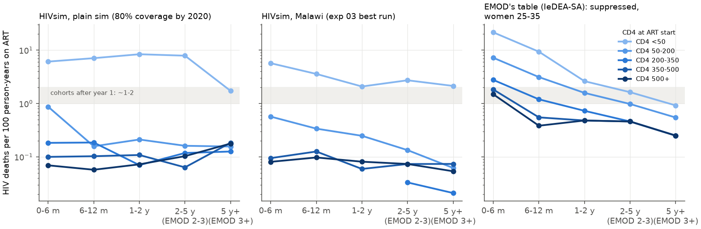
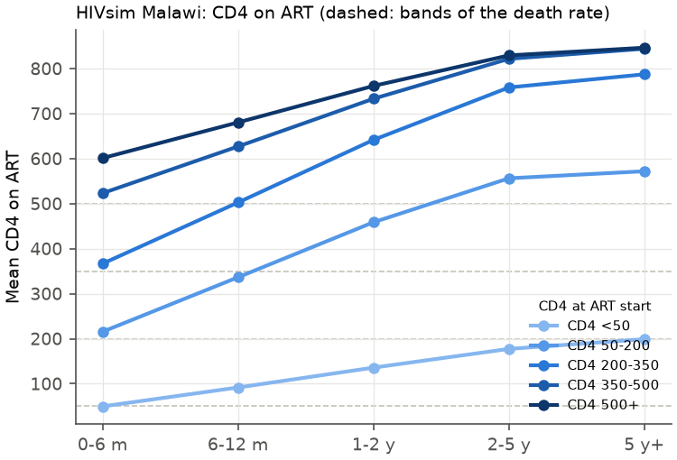
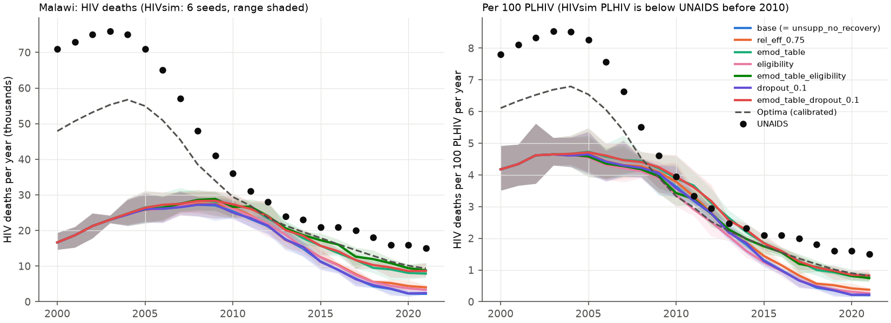

# 13: HIVsim's mortality on ART — summary

**Date:** 2026-11-09. STIsim PR #612 (`rs-v4-art-split`, 6058d5c), Starsim `/tmp/ss-nov09`, env `hp_rc3`. See `README.md` for the method; numbers are in `outputs/` (`tables.txt` has the printed tables), figures in `figures/`.

**Question.** Is HIVsim's mortality on ART too low, and why?

**Answer.** Yes, and by a lot: 0.15 HIV deaths per 100 person-years on ART in the Malawi runs, 2015-2021 (0.28 in the plain sim). Optima′ has 0.71, EMOD's table gives about 0.9 for the same people, and cohorts report about 1-3 (all-cause). The cause is the model's structure, not a parameter. On ART, HIVsim applies the off-ART death rate at the *current* CD4 count × 0.25, and the CD4 count recovers within months, so the rate falls at once to the floor of the CD4 table (0.003/yr above CD4 350 × 0.25 ≈ 0.08%/yr). `ART.init_pre()` also caps on-ART mortality at the off-ART rate for the current CD4 count, so no allowed parameter value can give cohort-like rates. Basing on-ART mortality on CD4 at ART start and time on ART (EMOD's IeDEA-SA table) raises Malawi HIV deaths 2015-2021 from 0.31× to 0.60× UNAIDS (2021: 0.15× to 0.53×), close to Optima (0.73×). Most of the remaining gap is in the untreated, not on ART: under a coverage target, nobody spends time off ART after stopping, and people start ART with CD4 counts that are too high.

## 1. HIVsim's death rate on ART

HIV deaths (`art_death`, plus `post_art_death`, `hiv_death` and `aids_death` among those on ART at the start of the step) per 100 person-years on ART. Rows are CD4 at first ART start, columns time since first start. Plain `hivsim.Sim`, 80% coverage by 2020, 6 seeds × 30,000 agents:

| CD4 at start | 0-6 m | 6-12 m | 1-2 y | 2-5 y | 5 y+ | share of person-years |
|---|---|---|---|---|---|---|
| <50 | 6.1 | 7.1 | 8.4 | 7.9 | 1.7 | 4% |
| 50-200 | 0.87 | 0.16 | 0.21 | 0.16 | 0.16 | 19% |
| 200-350 | 0.18 | 0.19 | 0.07 | 0.12 | 0.13 | 9% |
| 350-500 | 0.10 | 0.10 | 0.11 | 0.06 | 0.18 | 37% |
| 500+ | 0.07 | 0.06 | 0.07 | 0.10 | 0.18 | 32% |
| **all on ART** | | | | | | **0.28** (non-HIV deaths 0.99) |

Malawi (exp 03 best run, 6 seeds × 50,000 agents) is lower still, at 0.14 overall: 0.57 / 0.34 / 0.25 / 0.13 / 0.06 for CD4 50-200 at start, and about 0.08 for 350+ at every duration (`outputs/malawi_rate_by_cd4_dur.csv`).

**What drives it** (`sti.ART.on_art_death_rate`, `cd4_increase`):
- **The rate depends on the current CD4 count:** HIV's `cd4_death_rates` [0.003, 0.003, 0.005, 0.01, 0.05, 0.30]/yr for CD4 bands >500, 350-500, 200-350, 50-200 and <50, × `rel_art_mortality_effective` 0.25 (non-suppressed: 0.7 for men, 0.35 for women), × `art_death_age` (1-1.32), × `rel_death_f` 0.74 for women. `art_death_dur` is `None`, so time on ART has no effect of its own.
- **CD4 recovers within months.** Starters at CD4 50-200 average 216 in the first 6 months, 337 at 6-12 months and 459 at 1-2 years (figure 2). Their rate drops from 0.05×0.25 = 1.25%/yr to 0.25%/yr within the first year, and to 0.08%/yr after that.
- **The floor is tiny:** above CD4 350, 0.003-0.005 × 0.25 ≈ 0.08-0.13%/yr.
- **A cap:** `init_pre()` raises an error if max(rel_art_mortality) × max(age mult) × max(dur mult) > 1. On-ART mortality can't exceed the off-ART rate at the *recovered* CD4 count, so the most a parameter can give is `rel_art_mortality_effective` = 0.75 (= 1/1.32). That raises the on-ART rate only to 0.35%/yr (Malawi, variant `rel_eff_0.75`).
- **The people on ART are too healthy at the start:** in Malawi, 90% of ART person-time in the first 6 months in 2004-2010 is from starts at CD4 ≥350 (77-78% of all person-time on ART). In those years Malawi's guidelines limited ART to CD4 <200, then <350. The reasons: general testing finds people in the 10-year latent stage, where HIVsim's CD4 is flat at ~500; the coverage target fills places regardless of eligibility; and the 350→200 decline in the `falling` stage takes under a year, so few people are caught at 200-350.
- **Starters below CD4 50 hardly recover** (mean 199 after 5 years), because the potential gain is proportional to CD4 at start (`cd4_potential = cd4_preart·(1 + (1000 − cd4_preart)/500·ln(1000/cd4_preart))`: 15 for a start at 1, 173 at 20). This group is the only one with high rates (2-8%/yr), but it holds 1-4% of person-time.

## 2. Comparison

HIV deaths per 100 person-years on ART (EMOD and the literature: by CD4 at start; Optima: by current CD4 band):

| | 0-6 m, CD4 50-200 | 6-12 m | 1-2 y | 2 y+ | starts at CD4 350-500, 0-6 m / 2 y+ | everyone on ART, Malawi 2015-21 |
|---|---|---|---|---|---|---|
| **HIVsim** (plain / Malawi) | 0.87 / 0.57 | 0.16 / 0.34 | 0.21 / 0.25 | 0.16 / 0.06-0.13 | 0.10 / 0.06-0.18 | **0.15** (suppressed 0.14, non-suppressed 0.30) |
| **EMOD′** `ARTMortalityTable` (suppressed, women 25-35; men ~10-20% higher) | 7.2 | 3.1 | 1.6 | 1.0 (2-3 y), 0.55 (3 y+) | 1.8 / 0.25-0.46 | 0.91 (as variant `emod_table` in HIVsim) |
| **Optima′** (Malawi calibrated) | by current CD4 on suppressive ART: <50 7.4, 50-200 1.36, 200-350 0.20, 350-500 0.13, >500 0.08 | | | | | **0.71** (suppressed 0.33, non-suppressed 3.06); off ART: untreated 2.29, lost 2.89 |
| **Cohorts** | first-year excess 17.5 for CD4 <25 and WHO stage III/IV [1] | | | | excess 0.27 after year 1 for CD4 ≥200, stage I/II [1] | crude 8.3 [2], 3.1 [4]; 9.7% die in year 1, 16.6% by 4 years (≈2.4%/yr in years 2-4) [3] |

[1] Brinkhof MWG et al., Mortality of HIV-infected patients starting antiretroviral therapy in sub-Saharan Africa: comparison with HIV-unrelated mortality. *PLoS Med* 2009;6(4):e1000066 (IeDEA and ART-LINC, 13,249 patients, 4 countries). [2] Johnson LF et al., Life expectancies of South African adults starting ART. *PLoS Med* 2013;10(4):e1001418 (IeDEA-SA, 6 cohorts linked to the population register; 83.2 per 1,000 PY overall). [3] Boulle A et al., Mortality in patients with HIV-1 infection starting ART in South Africa, Europe, or North America. *PLoS Med* 2014;11(9):e1001718 (South African cohorts, corrected for unascertained deaths). [4] Cornell M et al., *J Int AIDS Soc* 2017 (72,812 South African adults, 350,376 PY, crude 3.08/100 PY; mortality close to HIV-negative by 48 months). Cohort rates are all-cause; the HIVsim and model columns are HIV deaths only, and HIVsim's non-HIV deaths on ART are ~0.5-1/100 PY.

**Reading:**
- In the first year, for low-CD4 starts, HIVsim is about 10× below EMOD and the cohorts.
- After year 1, HIVsim is 5-10× below EMOD for every CD4 at start.
- For healthy starts after year 1, HIVsim (0.1-0.2) is near Brinkhof's 0.27 excess. The gap is concentrated in early mortality, in later mortality after low-CD4 starts, and in HIVsim's too-healthy mix of starters.
- Optima's structure is close to HIVsim's (CD4 band × 0.23 on suppressive ART). But its CD4 recovers slowly (one band per 0.7-2.2 years), its non-suppressed lose CD4 and die at 0.49× the off-ART rate, and it has 'lost' and untreated people with low CD4. That gives 5× HIVsim's on-ART rate, and Optima's 2021 deaths are 38% on ART.

## 3. Diagnosis, and the effect of each change on Malawi deaths

Malawi variants (6 seeds each; `run.py`, `MALAWI_VARIANTS`; `outputs/malawi_summary.csv`). The changes are subclasses of `sti.ART` in `run.py`; STIsim is unchanged.

| Variant | Deaths 2015 / 2018 / 2021 (× UNAIDS) | 2015-21 total × UNAIDS | On-ART rate 2015-21 (/100 PY) | Share of HIV deaths on or after ART, 2021 |
|---|---|---|---|---|
| base | 0.54 / 0.24 / 0.15 | 0.31 | 0.15 | 0.51 |
| `rel_eff_0.75` (largest value the cap allows) | 0.60 / 0.31 / 0.27 | 0.39 | 0.35 | 0.70 |
| `unsupp_no_recovery` (no CD4 gain on non-suppressive ART) | same as base | 0.31 | 0.15 | 0.51 |
| `dropout_0.1` (`rate_art_dropout` 0.1/yr) | 0.53 / 0.26 / 0.16 | 0.31 | 0.15 | 0.48 |
| `eligibility` (first start only below Malawi's CD4 threshold of the year, or pregnant from 2011) | 0.59 / 0.31 / 0.22 | 0.37 | 0.15 | 0.43 |
| **`emod_table`** (rate by CD4 at start × time on ART × age × sex × suppression, EMOD's IeDEA-SA table) | **0.75 / 0.53 / 0.53** | **0.60** | **0.91** | 0.83 |
| `emod_table_eligibility` | 0.82 / 0.67 / 0.59 | 0.69 | 0.92 | 0.82 |
| `emod_table_dropout_0.1` | 0.75 / 0.57 / 0.58 | 0.62 | 0.96 | 0.83 |
| Optima (calibrated, for reference) | 0.85 / 0.72 / 0.62 | 0.73 | 0.71 | 0.38 |

**Diagnosis:**
1. **Main cause: a missing mechanism.** Mortality on ART is anchored to the current, quickly recovered CD4 count and capped by the off-ART rate. There is no excess mortality by time on ART or by CD4 at the start. Changing the mortality model alone doubles deaths 2015-2021 (0.31× to 0.60× UNAIDS) and gives an on-ART rate between Optima's and the cohorts'. No parameter of the current model gets there: the cap allows at most 0.39×.
2. **Not the cause:** CD4 recovery on non-suppressive ART (no effect, since the rate hardly varies above CD4 350) and the size of the non-suppressed group.
3. **A second gap, off ART: stopping ART doesn't leave anyone off ART.** With a coverage target, people who stop (at the end of `dur_on_art`, or by `rate_art_dropout`) are back in the pool of those waiting (`ti_art ≤ ti`) and are restarted at once: there are 347 person-years off ART after starting, against 180,000 on suppressive ART (2015-21, 6 seeds). With dropout at 0.1/yr there are still only 2,100. So disengagement, and the deaths of people who re-present with advanced HIV, can't be represented. This is why HIVsim's share of HIV deaths on ART (0.83 with the table) is above the 35-64% that the models give (Bansi-Matharu 2026) and above Optima's 0.38. Never-treated people do die at 1.6%/yr (Optima: untreated 2.3%, lost 2.9%), but there are too few of them, and too few with low CD4.
4. **Starts at high CD4.** Too many people start ART at high CD4 (90% at ≥350 in 2004-10), because the latent CD4 is flat at ~500 and coverage is filled regardless of eligibility. With the table, CD4 eligibility adds another 0.09 (0.60× to 0.69×). It also leaves 2021 coverage below target (0.75 against 0.80), so the two effects are mixed here.

## 4. Proposed STIsim change (minimal)

In `sti.ART` (`stisim/interventions/hiv_interventions.py`):

1. **On-ART mortality by CD4 at ART start and time on ART** (the main change, which the `emod_table` variant tests). `on_art_death_rate()` should take its base rate from a new parameter, `art_death_table`: annual HIV death rates by time since the latest ART start (`ti_art`: 0-6 m, 6-12 m, 1-2 y, 2-3 y, 3 y+) × CD4 at that start (`cd4_preart`, interpolated over 0-625). Its default would be EMOD's IeDEA-SA suppressed table at ages 25-35, with the male/female difference and age kept by the existing `rel_death_f` and `art_death_age`. A multiplier for non-suppressive ART replaces `rel_art_mortality_unsupp_*`: EMOD's non-suppressed/suppressed ratio is ~1.5-2× after 6 months. The `init_pre()` cap would then be dropped (or apply only when the old mode is chosen), because cohort mortality on ART *is* above the off-ART rate at the recovered CD4 count. To keep old results reproducible, `art_death_table=None` would keep the current behaviour. About 30 lines; `ARTByStartCD4.on_art_death_rate` in `run.py` is a working sketch (a piecewise-constant hazard, without EMOD's redraw from ART start). **Expected effect on Malawi:** HIV deaths 2015-2021 from 0.31× to about 0.60× UNAIDS; 2018 from 0.24× to 0.53×; 2021 from 0.15× to 0.53× (2,200 → 7,900, against UNAIDS 15,000 and Optima 9,300); on-ART rate from 0.15 to 0.9 per 100 PY; earlier years barely change (2010: 0.70× to 0.75×).
2. **Disengagement that takes time** (second, for the share of deaths on and off ART). When someone stops (by `dropout` or the end of `dur_on_art`), set `ti_art` to a re-engagement time drawn from a new `dur_reengage` parameter (or require re-referral), so that a coverage target can't restart them in the next step. Without it, `rate_art_dropout` has no effect on deaths under a coverage target (0.31× to 0.31×).
3. **Smaller fixes found along the way** (separate issues):
   - (a) `art_cd4_growth` is per *step* (`dur_art` is counted in steps in `cd4_increase`), so CD4 recovery speed changes with `dt`.
   - (b) `cd4_potential` ∝ `cd4_preart`, so starters below CD4 ~20 never recover (potential 15 for a start at 1).
   - (c) `post_art_dwell` is `ln(cd4_preart)·cd4/cd4_potential` years. That is 0 for someone restarted at CD4 ≈ 1, who then dies in the step they stop. In the plain sim, 73 of 226 HIV deaths among people suppressed at the start of a step were `post_art_death` in that same step.
   - (d) 13 `aids_death`s among people on ART (an edge of `hold_hiv_exits`; that workaround has since been replaced by a Starsim fix in starsim#1573).
4. **For the Malawi calibration (not STIsim):** with change 1, people starting at high CD4 (latent CD4 flat at 500; no CD4 eligibility under a coverage target) matter more, because mortality then depends on CD4 at start. The planned exp 04 (low-CD4 testing from 2004) and a CD4 eligibility rule by year should be fitted with the new mortality.

## Caveats

- **The Malawi runs are a re-tuned exp 03 best run, not a calibrated model.** Under #612 the exp 03 best parameters give 2.3M PLHIV in 2021, so `beta_m2f` was halved to 0.004 (2021 PLHIV 1.08M, coverage 0.80). PLHIV and deaths before 2010 are well below UNAIDS (figure 3), so read the variants as relative to base after 2010, or per PLHIV. (The over-transmission on declared STIsim v4 is analysis 11's open item.)
- `hivsim_malawi/hivsim/malawi.py` was written for Starsim 4.0.0rc1; `run.py` aliases `ss.MaternalNet = ss.PrenatalNet` to run it.
- EMOD's table is from 2000s IeDEA-SA cohorts with late starts. Mortality on ART has fallen since (e.g. starts at higher CD4, better regimens), so the table may overstate deaths after 2016 for the same CD4 at start. Even so, at 0.53× UNAIDS in 2021 it doesn't overshoot.
- 50,000 agents, 6 seeds: the 2021 seed SD is ~100 deaths (base) to ~1,100 (`emod_table`), small next to the differences between variants.
- The analyzer counts as "on ART" anyone on ART at the start of a step. Deaths of people who stopped in that step are counted on ART, which is how cohorts count them (intention to treat).

Sources: [Brinkhof 2009](https://pmc.ncbi.nlm.nih.gov/articles/PMC2667633), [Johnson 2013](https://pmc.ncbi.nlm.nih.gov/articles/PMC3621664), [Boulle 2014](https://journals.plos.org/plosmedicine/article?id=10.1371/journal.pmed.1001718), [Cornell 2017](https://boris.unibe.ch/109510/1/Cornell%20JIntAIDSSoc%202017.pdf)
