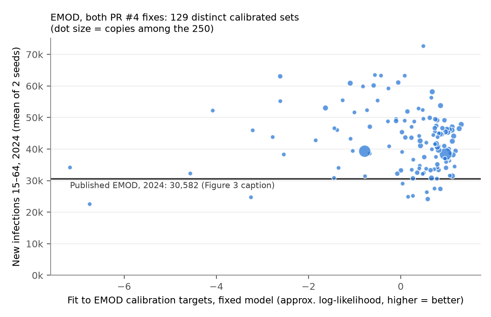

# 25: EMOD with both fixes over all 250 calibrated sets — summary

**Answer:** the ~35% excess in total new infections is not about which parameter sets we ran.
- All 250 sets with Daniel's two fixes give a median of 40,900 new infections at ages 15–64 in 2024 (mean 42,400; 5–95% 30,700–60,100). The published 30,582 sits at the 4th percentile.
- Neither the best-fitting sets nor Daniel's top-ranked sets come closer. The total is essentially unrelated to fit.
- Every group of sets reproduces the Figure 3A shares within about 5 points. No group gives both the shares and the total.
- **The likely cause is the campaign file.** The published runs used `campaign_Malawi_20220422_recalib.json` (named at `models/emod/reference/source/config.json:24`, and in the experiment `Baseline-campaign_Malawi_20220422_recalib-transmission___2023_11_04` at `mwi_transmission.Rmd:37`). That file is not in the repo; we run `campaign_Malawi_20251215.json`.
- Same parameter sets as ours: `script.sbatch:22` runs the transmission suite on `resampled_parameter_sets_20230424.csv`. Nothing points to later sets; "recalib" is part of the campaign's file name.

Runs: emod-hiv 2.37.0, analysis 18's both-fixes inputs, 129 distinct parameter vectors (all 250 sets, weighted by copies) × seeds 1–2, to 2025; 258 runs, none failed (`launch.py`, `run.py`). Scaling as Daniel's Rmd (× 17,563,749 / sim population at 2018.5; recipients 15–64).

## 2024 new infections (`outputs/summary.txt`, `outputs/groups.csv`)

| Sets | 2024 new infections |
|---|---|
| All 250 (weighted) | median 40,900; mean 42,400; 5–95% 30,700–60,100 |
| Top 10 / top 25 by fit under the fixed model | 41,700 / 40,600 |
| Top 10 / top 25 by Daniel's likelihood | 42,600 / 43,300 |
| Published (Fig 3 caption) | 30,582 (4th percentile of ours) |

- **Total vs fit:** Spearman −0.15 (p = 0.10) with our fit score; 0.04 with Daniel's likelihood column.
- **Fit score:** an approximation of Daniel's likelihood from the ingest form's weights (`fit.py`). The dtk-tools scoring code isn't available. It agrees with his `likelihood` column at Spearman 0.39 on the PR #1 files and 0.65 with the fixes.
- **Shares:** on ART is about 5 points high and interrupted 4–5 points low in every group. The 18 sets within 10% of 30,582 match the shares slightly worse (interrupted 13% against 17% in 2020).

## Other candidates checked

- **Counting:** the Rmd's "overall" new infections (`mwi_transmission.Rmd:183–189`) average men and women rather than add them. Half of 41k is about 20k, which doesn't give 30.6k either, but which number the caption reports should be confirmed.
- Ages (15–64 vs all ages) change totals by about 2% (analysis 18).

## Questions for Daniel

1. Can you send `campaign_Malawi_20220422_recalib.json`, the campaign behind the November 2023 results, and say how it differs from `campaign_Malawi_20251215.json` (especially testing and ART after 2015)?
2. Is 30,582 the Rmd's `mean.new.infections.overall` or the sum over sexes? Which ages, which year step, and how many sims?
3. Did the published runs have the mortality fix but not the dropout fix, or neither, or both?
