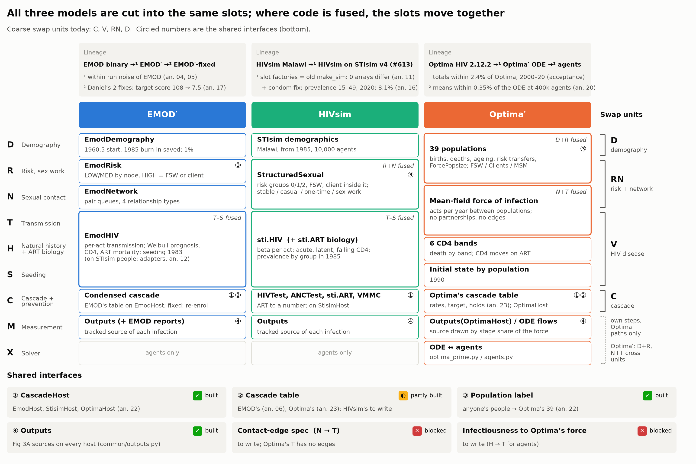
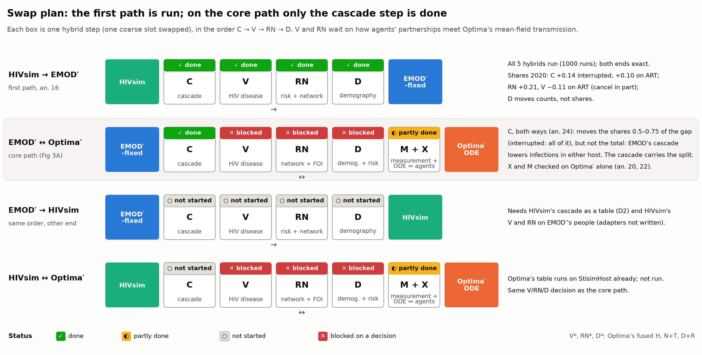
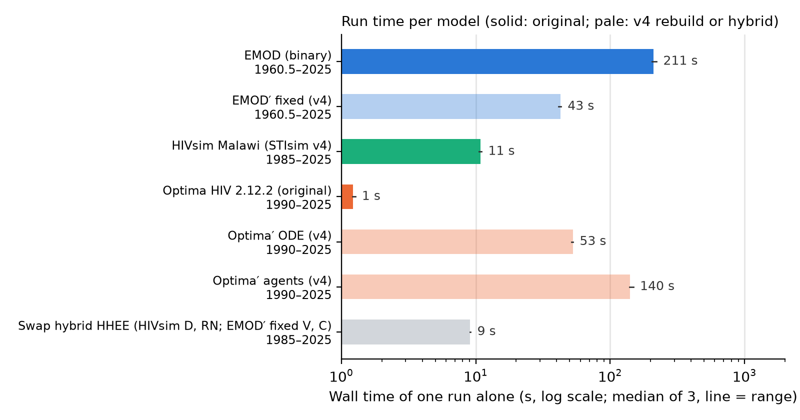
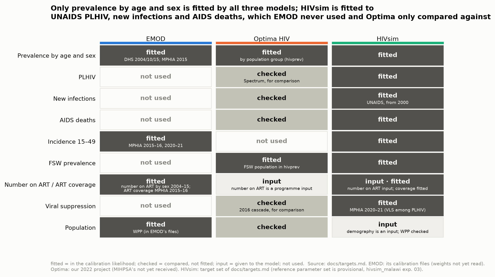
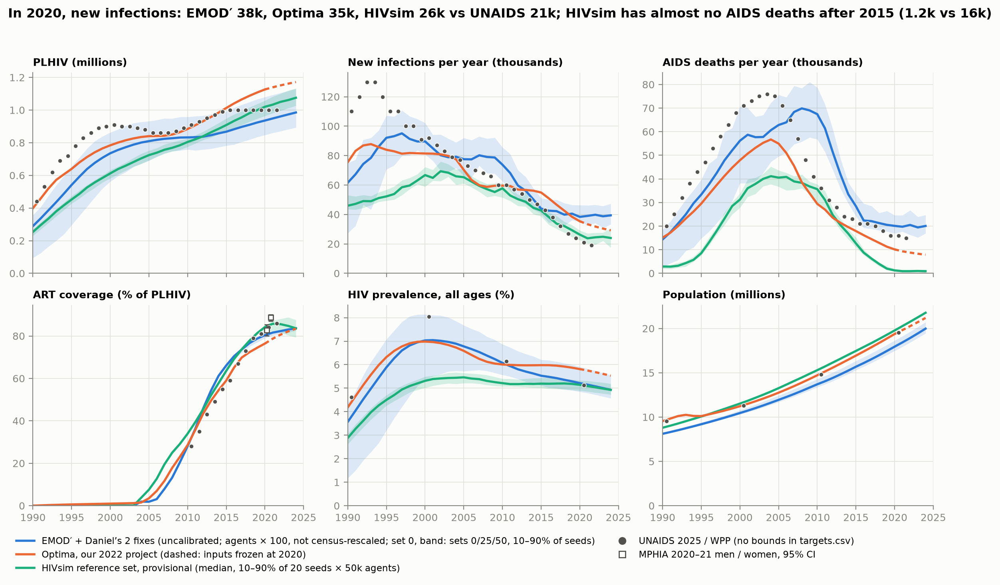
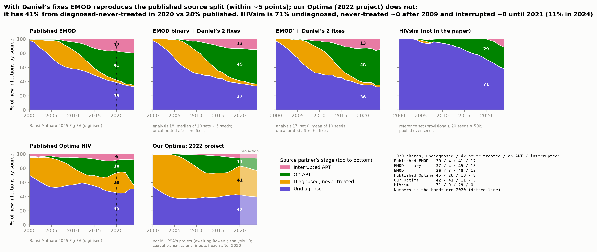
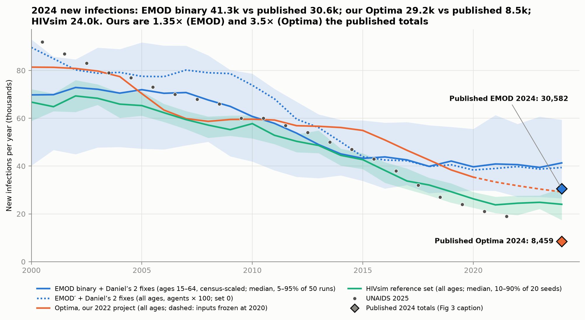

# Sprint 3 readout (team check-in, 10 Nov 2026)

*Robyn, Daniel, Cliff. Covers sprints 1–3 (20 Oct–9 Nov). Plan from sprint 4: `docs/plan.md` on `main`. Analyses are on branch `starsim-rc3`.*

## Headlines

1. **The question is now sharper: decompose Figure 3A of Bansi-Matharu et al. 2025.** Why do EMOD and Optima HIV disagree, in Malawi, on who new infections come from (undiagnosed / diagnosed never treated / on ART / interrupted ART), and on how many there are (30.6k vs 8.5k in 2024)? `core_question.md` on `main`.
2. **All three models are rebuilt in Starsim v4 and verified against their originals.** EMOD′ reproduces EMOD within run-to-run noise, Optima′ is within 2% of Optima (ODE) and its agent form is within 0.35% of the ODE, and HIVsim runs on STIsim v4.
3. **The swap machinery works.** A runner, slot factories, endpoint-identity tests and an outputs analyzer are in place. The first path (HIVsim → EMOD′) ran end to end with exact endpoints, and the first step of the core path (the cascade, EMOD′ ↔ Optima′, both ways) is done.
4. **First result: the cascade carries most of the split by treatment status, not the gap in totals.** Swapping the cascade moves 0.5–0.75 of the gap in "diagnosed, never treated" and "on ART", and all of the gap in "interrupted". New infections move the other way, so the total must come from natural history, transmission, network or demography. With Optima's PMTCT now on (decided today; it had been skipped on agent hosts), Optima's cascade on EMOD′ adds +16.9k new infections in 2020 (95% CI 14.7–19.1k; was +20.9k with PMTCT skipped). With EMOD's VMMC and PrEP kept, it adds +4.3k. The shares barely move.
5. **The references are the bottleneck.** The EMOD binary with Daniel's two fixes reproduces the published shares, but its total is ~35% high across all 250 sets. The published runs used a campaign file we don't have (analysis 25). Our Optima project is not the one MIHPSA published, and we need Rowan's.

## 1. How each model is decomposed

Every model is cut into the same slots: D demography, R risk and sex work, N sexual contact, T transmission, H natural history and ART biology, S seeding, C cascade and prevention, M measurement, plus X solver for Optima. The first swaps use four coarse slots, **C, V (= T + H + S), RN, D**, because some slots are fused in code today. Details: `swap_design.md` §1.

## 2. The swap plan, and progress against it

| Path | C | V | RN | D | Status |
|---|---|---|---|---|---|
| HIVsim → EMOD′ (first milestone) | ✅ | ✅ | ✅ | ✅ | All 5 hybrids run, 1,000 runs, endpoints exact (analysis 16). Uncalibrated, not yet compensated |
| **EMOD′ ↔ Optima′ (core)** | ✅ both ways (24) | ⛔ needs design | ⛔ needs design | ⛔ needs design | Prerequisites done: Optima′ as agents (20), population label and host (22), Optima's cascade as a table (23) |
| EMOD′ → HIVsim | ○ | ○ | ○ | ○ | Needs HIVsim's cascade as a table (the pathway types now exist, from 23) |
| HIVsim ↔ Optima′ | ○ | ○ | ○ | ○ | Becomes cheap once the core path exists |

✅ done · ⛔ blocked on a decision · ○ not started.

| Milestone in the plan | Planned | Status |
|---|---|---|
| CRN decision | sprint 3 | ✅ Pairing helps stocks, not shares (14); engine leak fixed (starsim#1574) |
| Component boundaries approved (P4) | sprint 4 | ◐ Drafted (`swap_design.md`, figure above); **for approval today** |
| Optima′ verified both ways | sprint 5 | ✅ ODE vs Optima 2% (P2), agents vs ODE 0.35% (20). Sign-off pending |
| Runner and endpoint test on a trivial swap | sprint 6 | ✅ (11, 15) |
| First path with endpoint identity | sprint 7 | ✅ Uncalibrated (16); compensated refit not built |
| EMOD′ ↔ Optima′ | sprint 8 / January | ◐ C step done (24) |

## 3. The models in numbers

Each model's wall time and peak memory are the median of 3 runs. Details and sources are in `model_stats.md`.

| Model | Horizon | Time per run | Memory | Population | Step | Sets |
|---|---|---|---|---|---|---|
| EMOD binary (fixed) | 1960.5–2025 | 211 s | 0.7 GB | 36.6k agents (1%) | month | 250 (129 distinct) |
| EMOD′ fixed | 1960.5–2025 | 43 s (9 s to 1985) | 0.8 GB | 36.6k agents | month | 250 |
| HIVsim | 1985–2025 | 11 s | 0.3 GB | 10k agents | month | 1, provisional |
| Optima HIV 2.12.2 | 1990–2025 | 1.2 s | 0.3 GB | 1,482 compartments | 0.2 y | 1 |
| Optima′ ODE | 1990–2025 | **53 s** | **1.9 GB** | 1,482 compartments | 0.02 y | 1 |
| Optima′ agents | 1990–2025 | 140 s | 1.8 GB | 100k agents | 0.02 y | 1 |
| Swap hybrid (HHEE) | 1985–2025 | 9 s | 0.4 GB | 10k agents | month | paired |

- **EMOD′ is 5× faster than the EMOD binary.** A whole swap path (5 hybrids × 200 cells) takes minutes on the 160-core machine.
- **Optima′ as an ODE is 44× slower than Optima.** A 10× smaller time step explains 10×; the rest is Starsim's declared-engine overhead. The profile points to two causes: a cache in the time-series parameter lookup that keeps missing during the run, and repeated searches of the whole object tree at `init` (40% of the time). A fix is being made on a local Starsim branch.

## 4. Epidemiology

**What each model is calibrated to.** Prevalence by age and sex is the only indicator all three are fitted to. EMOD never used the UNAIDS PLHIV, new infections or AIDS deaths, and Optima only compared against them.

**Core indicators, all three models against the data.** New infections in 2020: EMOD′-fixed 40k (census-rescaled), Optima 35k, HIVsim 25k, against UNAIDS 21k. ART coverage is close for all three. **Fixed today:** HIVsim now runs with mortality on ART (EMOD's table) by default, and `common/outputs.py` now counts deaths on and after ART. HIVsim's 2020 AIDS deaths went from 1.2k to 7.9k, against UNAIDS's 16k. Its parameter set was calibrated without either fix, so recalibrating is the next HIVsim experiment.

**Figure 3A: published (EMOD, Optima) and reconstructed (all three).**

2020 shares (undiagnosed / diagnosed never treated / on ART / interrupted):

| | Shares | New infections, 2024 |
|---|---|---|
| Published EMOD | 39 / 4 / 41 / 17 | 30.6k |
| EMOD binary with Daniel's fixes | 37 / 4 / 45 / 13 | 41.3k (1.35×) |
| EMOD′ with Daniel's fixes | 36 / 3 / 48 / 13 | 41.4k (census-rescaled) |
| Published Optima | 45 / 28 / 18 / 9 | 8.5k |
| Our Optima (2022 project) = Optima′ | 42 / 41 / 11 / 6 | 29.2k (3.5×; projection with inputs frozen at 2020) |
| HIVsim (provisional set, mortality on ART) | 73 / 0 / 27 / 0 | ~25k |

- **EMOD:** with Daniel's fixes, the published split is reproduced and the total isn't.
- **Optima:** neither is, because our project is a different calibration from MIHPSA's.
- **HIVsim's split is structural:** ART is filled to a number from whoever is diagnosed, so almost nobody stays diagnosed without treatment. Anyone who stops is restarted within the same step, because ART is held at a number, so "interrupted" stays near 0 until the coverage input falls (2021). We checked: this is HIVsim's structure, not a counting bug. That is a third answer to the Figure 3A question, and the swaps can explain it.

## 5. Calibration stage gates

These are the ten steps of the calibration workflow. ✅ done · ◐ partly · ○ not started · — inherited from the original model.

| Gate | HIVsim (our calibration) | EMOD′-fixed | Optima′ | Compensated refit of hybrids (tier 2) |
|---|---|---|---|---|
| 1. Data | ✅ target set agreed (`targets.md`) | — EMOD's targets | — Optima's data | ✅ the HIVsim target set |
| 2. Visualise, model setup | ✅ 10,000 agents, seeds measured | ✅ 1% scale | ✅ | ◐ run cost known (stats table) |
| 3. Coverage check | ✅ exp 01 | — | — | ○ |
| 4. Targets and likelihood | ✅ stopping rule (3 Nov) | — | — | ◐ two knobs chosen (transmission scale, ART uptake) |
| 5. Workflow | ✅ experiments, READMEs, SUMMARYs | ✅ | ✅ | ✅ runner, store, manifest |
| 6. Edge cases | ◐ take-off on other demographies (21) | ✅ | ✅ | ◐ seeding (D11) |
| 7. Re-identification | ○ | — | — | ○ |
| 8. Parameter engineering | ◐ knobs provisional | — | — | ✅ two knobs |
| 9. Small real-data calibration | ✅ exp 03 | — 250 sets (Daniel) | — one fit | ○ |
| 10. Iterate | ◐ **exp 04: stopping rule not met** (2/600 runs); PLHIV before 2010 too low | ◐ **the two fixes invalidate the original fit:** score 108 → 7.5 uncalibrated, total ~40% high | ◐ **not MIHPSA's calibration** (19) | ○ |

Structural fixes found through calibration: declared STIsim ignored condoms (prevalence 19% → 8%); HIVsim's mortality on ART was 5–10× too low (13); EMOD's dropout trap and background mortality bug (Daniel, PR #4).

**Analyses to rerun with the fixed HIVsim** (mortality on ART, deaths counted after ART): 13–16 and 21–23, plus 07 (cascade on STIsim). Analysis 24 doesn't use HIVsim.

## 6. What we need to clarify

**References (critical path)**
1. **EMOD (Daniel): can we replicate the published EMOD?** The shares, yes; the total, not with the files we have.
   - With his two PR #4 fixes, the shares are within 5 points of Figure 3A.
   - **Analysis 25:** all 250 sets give a median of 40.9k new infections in 2024 (5–95% 30.7–60.1k), against the published 30.6k (our 4th percentile). Neither the best-fitting sets nor his top-ranked ones come closer, so it isn't the choice of sets.
   - **The published runs used a different campaign:** `config.json:24` and his scaling script (`mwi_transmission.Rmd:37`) name `campaign_Malawi_20220422_recalib.json`, run 4 Nov 2023. That file isn't in PR #1; we run `campaign_Malawi_20251215.json`. The parameter sets are the same (April 2023).
   - **a.** Can we have `campaign_Malawi_20220422_recalib.json`, and how does it differ from the 20251215 file (testing and ART after 2015)?
   - **b.** Is 30,582 the Rmd's `mean.new.infections.overall`, which averages over sexes rather than adding them, or the sum? Which ages and years, and how many sims?
   - **c.** Did the published runs have the mortality fix, the dropout fix, both or neither?
   - **d.** Once we have the right campaign: does the fit hold, or do we refit?
   - His PR #4 review questions (`notes_for_daniel.md`) haven't been sent yet.
2. **Optima (Rowan, via Robyn):** MIHPSA's Malawi project. Until it arrives we decompose against our 2022 project, stated as such.
3. **Year and outputs:** 2020 (inside the data, where Optima′ is verified) or 2024 (the caption's totals, which need Optima's post-2020 inputs)?

**Swap design**

4. **V, RN and D between EMOD′ and Optima′:** Optima has no network. Options: Optima's mean-field force of infection running on agents, or an agent network fitted to Optima's mixing. Or put transmission and network in one step.
5. **Slot boundaries (P4 sign-off):** PMTCT is in C (decided 10 Nov). Are EMOD's VMMC and PrEP in C, or prevention outside it? Analysis 23 has 11 more provisional decisions, plus ART arm switching on `EmodHost`.
6. **Seeding (D11):** condition on take-off, make seeding its own step, or seed more? The shares are robust to the choice; the counts aren't (21).
7. **Compensated refit:** the knobs and targets are agreed. Does the refit use the full stopping rule, or a cheaper subset, per hybrid?

**Calibration**

8. **HIVsim:**
   - Mortality on ART is now on, so calibration has to resume. Exp 05 would refit with it. Should we relax the stopping rule (exp 04: 2/600 runs pass)?
   - Should HIVsim get explicit dropout and re-engagement (`dur_reengage`)? Without them, its "interrupted" share is near 0, so its Figure 3A split differs by construction.

**Engineering and process**

9. **Starsim:** review of #1573 and #1574 (Cliff). How do we land the five local friction fixes?
10. **Sprint cycle:** keep weekly Tuesday check-ins with a readout each time?

## Sources

Analyses 01–24 (`analyses/NN_*/SUMMARY.md` on `starsim-rc3`); `docs/status_2026-11-09.md`; hivsim_malawi experiments 01–04.
