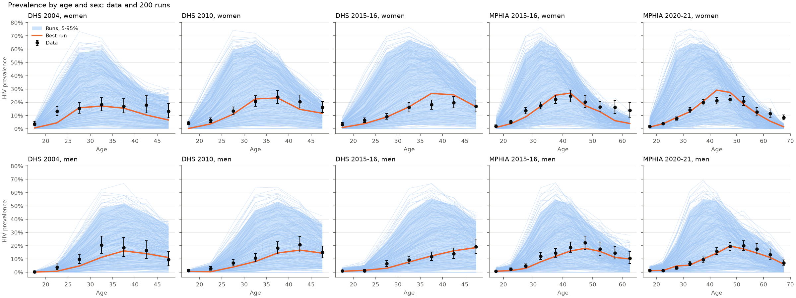
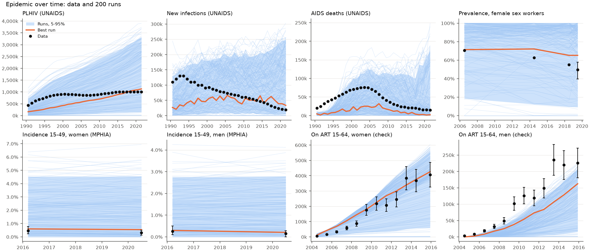

# Exp 01 — Can HIVsim Malawi reach the targets?

**Date:** 2026-11-02.

**Question.** Over plausible ranges for nine uncertain parameters (`config.yaml`), does HIVsim Malawi produce runs that bracket the targets in `results/targets.csv`? See `README.md`.

**Result.** Target by target, yes: 102 of 104 survey prevalence points, all UNAIDS PLHIV and new infections, 27 of 32 AIDS deaths, and all FSW and incidence points lie inside the range of the 200 runs. But the epidemic's shape over time is not reached. No run has both the early epidemic (new infections over 80,000 a year in 1990-95; UNAIDS 110,000-130,000) and its decline (under 40,000 by 2020; UNAIDS 21,000). In the median run, new infections in 2020 are 1.45 times the 1990-95 peak; in the data they are 0.16 times it.

## Coverage

From `outputs/coverage_table.csv` (in range: between the lowest and highest run; in 90%: between the 5th and 95th percentiles):

| Target | Source | Points | In range | In 90% |
|---|---|---|---|---|
| Prevalence by sex and age | DHS 2004 / 2010 / 2015-16 | 14 / 14 / 14 | 14 / 14 / 14 | 14 / 14 / 14 |
| | MPHIA 2015-16 / 2020-21 | 20 / 22 | 20 / 21 | 18 / 21 |
| PLHIV, new infections, AIDS deaths | UNAIDS 2025 | 32 each | 32 / 32 / 27 | 32 / 32 / 25 |
| FSW prevalence | FSW surveys | 4 | 4 | 4 |
| Incidence 15-49 by sex | MPHIA | 4 | 4 | 4 |
| On ART by sex (check) | Programme data (EMOD) | 24 | 13 | 12 |
| Population by sex and age (check) | WPP | 112 | 104 | 88 |

## Observations

1. **The age and sex pattern of prevalence is easy to reach.** The best run (by `targetfit.score`, which isn't a likelihood) follows the shape in all five surveys, for women and men (first figure). Only three points are outside the 90% band, all older women: 55-64 in MPHIA 2015-16 (16.1% and 13.9%; 95th percentile of runs 14.2% and 8.9%) and 65+ in MPHIA 2020-21 (8.5%; highest run 4.4%). The model has too little HIV in older women.
2. **The epidemic curve is not reached as a whole.** Each year's new infections is inside the range, but the runs that are large early stay large, and the ones that are small late were small early. 16 of 200 runs have 2020 new infections under half their 1990-95 peak; none falls to the data's 16%. The best run fits prevalence by age in 2004-2021 but has only 170,000 PLHIV in 1990 (UNAIDS 440,000) and 25,000-60,000 new infections a year throughout. FSW prevalence shows the same thing: 0.70 times its 2006 level in 2019 in the data, 0.96 in the median run.
3. **Early AIDS deaths are too low in every run.** 1990-1994 deaths are above the highest run (data 20,000-43,000; highest run 11,000-35,000), and 1995-1996 above the 95th percentile. With the epidemic seeded in 1985, too few people have been infected long enough to die by the early 1990s. EMOD and Optima both have early deaths too low as well.
4. **Too few men on ART, too many women early.** The ART total meets its input in the median run (99.7% in 2010, 2015 and 2020), but men on ART are below the data in nearly every run before 2015 (the best run has 0.43-0.55 times the data), and women above it before 2009. The split comes from testing: ANC testing reaches women, and general testing is the same for both sexes. In 5% of runs the ART total reaches only 13-15% of its input, from too few diagnosed.
5. **10,000 agents is enough for coverage.** Across 10 seeds of the central parameter set, the spread is 0.13-0.26 of the spread across the 200 parameter sets for every target except population (0.81, because the parameters barely move it) and suppression (0.01, set by the input). Runs took 30 s each with 150 in parallel (10 s alone).
6. **Unexplained: AIDS deaths jump after 2016 in some runs.** In 10% of runs, AIDS deaths in 2020 are over 2.6 times those in 2016 (upper band of the AIDS deaths panel). Not yet investigated.
7. **Target dating error, fixed after the run.** The numbers on ART labelled 2015.5 in EMOD's file were dated 2015.9 (DHS 2015-16's date) in `results/targets.csv` when this experiment ran; `make_targets.py` now dates them 2015.5. Only those two check points were affected.

## Next

The parameters can reach the targets one at a time; what's missing is a mechanism that bends the epidemic down after the early 1990s, and an earlier start. Proposed experiments, one change each:

- **02:** Does condom use scaling up over time (Malawi DHS data, in place of STIsim's default) and VMMC (`n_vmmc.csv`) let runs reach both the early peak and the decline?
- **03:** Does starting the epidemic earlier (1980, or seeding in 1985 with infections of a range of durations) bring early AIDS deaths into range?
- **04:** Does a separate testing level for men bring men on ART into range?
- **Plots:** add a joint check to `targetfit` (the share of runs inside every point's interval for a target, and the decline ratio), since point-by-point coverage hid observation 2.
