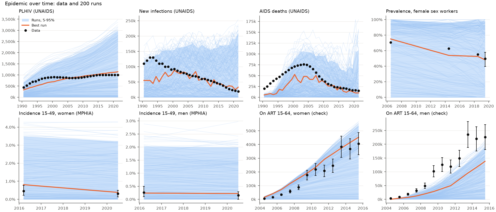
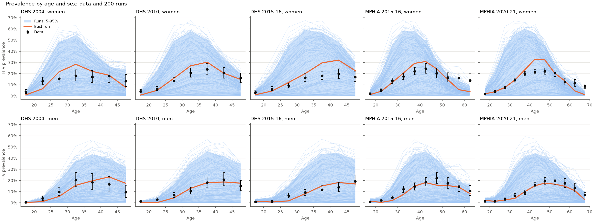

# Exp 02 — Do condom use and circumcision bend the epidemic down?

**Date:** 2026-11-02.

**Question.** [Exp 01](../01_coverage_check/SUMMARY.md) covered every target on its own, but no run had both Malawi's early epidemic and its decline, and it had no condom use or circumcision. With condom use (the Zimbabwe file's pattern scaled to MPHIA 2020-21, level varied by `condom_scale` 0.5-1.5) and circumcision by age (MPHIA 2020-21), can runs reach both? See `README.md`.

**Result.** The decline, yes; the early epidemic, not yet. New infections in 2020 over their 1990-95 peak have a median of 0.92 across runs (exp 01: 1.45; data 0.16), and 19 of 200 runs are within a factor of 1.5 of the data's ratio (exp 01: 4). The best run follows PLHIV and new infections from 2000-2005 on (within 4-16% of UNAIDS from 2010), but has half the data's new infections before 2000, and too few AIDS deaths before 2010. Still no run has new infections over 80,000 in 1990-95 and under 40,000 in 2020.

## Scorecard

| | Exp 01 | Exp 02 |
|---|---|---|
| Survey prevalence points in range / in 90% (of 84) | 83 / 81 | 83 / 78 |
| UNAIDS points in range (of 96) | 91 | 90 |
| New infections 2020 / peak 1990-95, median run (data 0.16) | 1.45 | 0.92 |
| Runs within x1.5 of that ratio | 4 | 19 |
| Runs within x1.5 of UNAIDS PLHIV every year | 0 | 4 |
| Runs within x1.5 of UNAIDS new infections, AIDS deaths every year | 0, 0 | 0, 0 |
| FSW prevalence 2019 / 2006, median run (data 0.70) | 0.96 | 0.87 |
| Best run's score (`targetfit.score`), median | 6.8, 44 | 5.2, 39 |

From `outputs/coverage_table.csv` and `outputs/trajectory_check.csv` (exp 01's trajectory numbers recomputed from its outputs with the same check).

## Observations

1. **Condom use is what bends the curve.** Across runs, `condom_scale` is correlated with a steeper decline (r = -0.34 with the 2020 / peak ratio), and the best run is near the top of the range (`condom_scale` 1.49, so condom use in non-low-risk partnerships reaches 74% by 2020, against MPHIA's 50% reported at last nonmarital sex). Six of the ten best runs have `condom_scale` above 1.1. Either reported condom use understates the level in these partnerships, or the decline also comes from something the model leaves out (fewer partners, later debut).
2. **The early epidemic is still too small.** Best run against UNAIDS: new infections 0.50 (1990) and 0.46 (1995) of the data, then 0.84-1.16 from 2000; PLHIV 0.70-0.77 before 2001, then 0.99-1.12; AIDS deaths 0.27 (1990) and 0.39 (1995). 1990-1995 AIDS deaths are above every run, as in exp 01. This is now the main gap, and it points at the start (seeding in 1985) rather than the parameters.
3. **Prevalence by age is still covered**, with the best run following the shape in all five surveys. It is a little high for women 35-50 in DHS 2015-16 and MPHIA 2015-16 (about 30% against 18-24%), and too low for women over 55, as in exp 01.
4. **The ART input is reached less often.** Median share of the input reached: 99% in 2010, 86% in 2015, 82% in 2020 (exp 01: over 99% throughout). With smaller epidemics, too few people are diagnosed for the ART numbers; testing is now limiting ART. Men on ART are still below the data in nearly every run before 2015.
5. **FSW prevalence now declines in the best run** (from 75% in 2006 to 49% in 2019; data 71% to 50%).
6. **Circumcision is reached.** In a check run, men circumcised in 2021: 37% at 15-19 (target 38%), 35% at 30-34 (32%), 30% at 50-54 (27%).
7. **Noise is as in exp 01:** seed spread 0.09-0.21 of the parameter spread for every target except population and suppression. Median run time 20 s with 150 in parallel.
8. **Still unexplained: AIDS deaths rise after 2016 in some runs** (2020 over 2016 above 2.06 in 10% of runs).

## Next

Robyn (2 Nov): the later epidemic matters more than the early one, and this is close; ART coverage and viral suppression should match well. So:

- **03:** Testing that varies by sex and over time, so that the ART input is reached, men on ART come into range, and ART coverage (UNAIDS) and viral suppression among PLHIV (MPHIA) match.
- The early epidemic (an earlier start or seeding) is set aside; the trajectory checks and the stopping rule cover 2000-2021 only.
- Keep `condom_scale` in the ranges.
