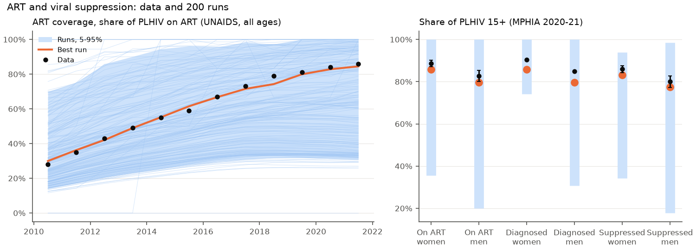
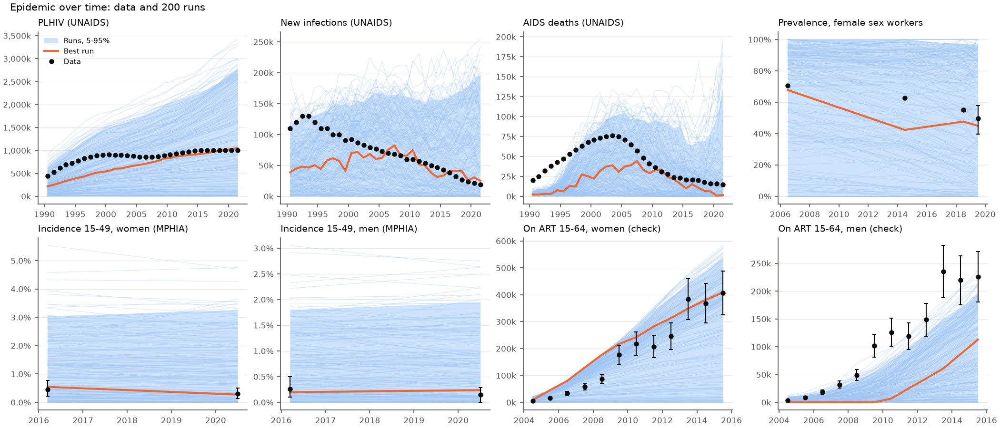
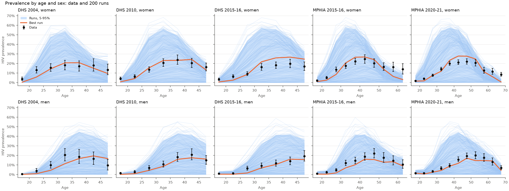

# Exp 03 — Can testing by sex and over time get ART coverage and viral suppression right?

**Date:** 2026-11-02.

**Question.** After [exp 02](../02_condoms_and_circumcision/SUMMARY.md), can runs match ART coverage (UNAIDS 2010-2021; MPHIA 2020-21 by sex) and viral suppression among PLHIV (MPHIA 2020-21 by sex), if men's testing (`test_rel_m`) and the start of the testing scale-up (`test_start`) vary? See `README.md`.

**Result.** ART coverage and suppression, yes: 12 of 200 runs are within 10 percentage points of UNAIDS ART coverage in every year 2010-2021, 23 are within MPHIA's intervals (plus or minus 5 points) for ART coverage and suppression in both sexes, and 9 do both. The median run now reaches 95% of the ART input in 2020 (exp 02: 82%). But they don't yet come with the rest: only 2 runs have both ART coverage and PLHIV right from 2005, and both get there with a late testing scale-up (2007-2009) that leaves almost no men on ART before 2010, against the programme data. When ART coverage is right, AIDS deaths after 2015 fall far below UNAIDS (the best run has 10% of them by 2021).

## Scorecard

| | Exp 02 | Exp 03 |
|---|---|---|
| ART input reached, median run, 2015 / 2020 | 86% / 82% | 97% / 95% |
| Runs within 10 points of UNAIDS ART coverage every year 2010-2021 | not measured | 12 |
| Runs within MPHIA intervals (+-5 points) for ART coverage and suppression, both sexes | not measured | 23 |
| Runs within x1.5 of UNAIDS PLHIV every year from 2005 | (4, from 1990) | 27 |
| Runs with both ART coverage and PLHIV right | | 2 |
| Men on ART, model / data, median over 2004-2015, median run | | 0.23 |
| Survey prevalence points in range / in 90% (of 84) | 83 / 78 | 82 / 77 |

Exp 02 didn't have the ART coverage targets, and its trajectory checks started in 1990.

## Observations

1. **ART coverage over time is easy to match.** The best run (score 5.7) follows UNAIDS ART coverage (30% in 2010 and 85% in 2021, against 28% and 86%), and is within 3 points of MPHIA 2020-21 for ART coverage and suppression in both sexes (on ART: women 86% against 88.7%, men 80% against 82.8%; suppressed: women 83% against 86.0%, men 77% against 80.1%).
2. **But it does so with late testing,** which conflicts with the early ART programme. The best run's `test_start` is 2009 and `test_rel_m` 1.96. Its men on ART are zero until 2009 (programme data: 3,000 in 2004 rising to 126,000 in 2010), 0.05 of the data in 2010 and 0.5 in 2015. Across runs, the median run has 0.23 of the data's men on ART. The two runs with both ART coverage and PLHIV right have `test_start` 2007 and 2009 and `test_rel_m` 2.0 and 2.5. The model ties all testing to one scale-up: low-CD4 testing, which should bring people with advanced HIV onto ART from 2004, starts with general testing.
3. **AIDS deaths fall too far when ART coverage is right.** Best run against UNAIDS AIDS deaths: 0.91 in 2010, 0.47 in 2015, 0.38 in 2018, 0.10 in 2021. HIV deaths in HIVsim almost stop once most PLHIV are on ART, while UNAIDS has 13,000-16,000 a year. This matters for the paper: deaths among people on ART are one of the quantities the models disagree on (35-64% of HIV deaths, Bansi-Matharu 2026), so HIVsim's mortality on ART should be checked before the swaps.
4. **New infections every year is too strict a check at 10,000 agents.** No run is within x1.5 of UNAIDS new infections in every year from 2005. With 10,000 agents, 2020's 21,000 infections are about 28 agents' infections, so single years vary by around 20% from noise alone. A 3-year average, or more agents for the final runs, would be fairer.
5. **Prevalence by age is still covered** (82 of 84 points in range), and the later epidemic is kept: 27 runs are within x1.5 of PLHIV every year from 2005.
6. **Noise:** seed spread 0.02-0.45 of the parameter spread; the largest is suppression among PLHIV (0.45), which the parameters move little because suppression among people on ART is an input.

## Next

- **04:** Low-CD4 testing (and ART for people with advanced HIV) from 2004, separate from the general testing scale-up, so that early ART reaches men and runs can have both the programme's early ART and the right ART coverage later.
- **05:** Check HIVsim's mortality on ART against the AIDS deaths after 2015 (and against the share of HIV deaths on ART that EMOD and Optima give), before any swaps.
- In `targetfit`, check new infections as 3-year averages.
- Stopping rule to agree with Robyn: enough runs (say 10) within 10 points of ART coverage every year, within MPHIA's intervals for ART coverage and suppression, within x1.5 of PLHIV from 2005, and with prevalence by age in the 90% band.
